# Awesome-Computer-Vision-Object-Tracking

 

 

**The Definitive Guide to Real-Time Multi-Object Tracking (MOT), Video Annotation Pipelines, YOLO/SAM Detection Runtimes & Edge Vision AI**

*Curated list of commercial enterprise SaaS platforms and state-of-the-art open-source GitHub repositories.*

**Last updated: November 2026** ⚡

---

## 📖 Overview

Welcome to **Awesome-Computer-Vision-Object-Tracking** 🚀! This repository curates notable **SaaS/hosted platforms** and **open-source frameworks** engineered for **Computer Vision & Object Tracking**. These tools detect, segment, track, annotate, train, and deploy real-time multi-object tracking (MOT) models across video streams, edge cameras, autonomous robotics, sports analytics, and dataset labeling pipelines.

- 🎯 **Leading Commercial Platforms**: Roboflow, Landing AI, Encord, Scale AI, Labelbox, V7 Labs, SuperAnnotate, Dataloop, Chooch, and Clarifai.
- 💻 **State-of-the-Art Open-Source Runtimes**: Meta SAM 2, Ultralytics YOLO, OpenCV, Supervision, ByteTrack, BoT-SORT, CoTracker, BoxMOT, FairMOT, CVAT, Label Studio, X-AnyLabeling, and Frigate NVR.

---

## 📑 Table of Contents

- [📊 Sector Overview & Market Dynamics](#-sector-overview--market-dynamics)
- [🏢 SaaS / Hosted Platforms](#-saas--hosted-platforms)
- [🔓 Open-Source GitHub Projects](#-open-source-github-projects)
- [🛠️ Frameworks for Building Custom Systems](#-frameworks-for-building-custom-systems)
- [📈 Star History](#-star-history)
- [🤝 How to Contribute](#-how-to-contribute)
- [☕ Support & Share](#-support--share)
- [⚖️ Disclaimer](#️-disclaimer)

---

## 📊 Sector Overview & Market Dynamics

The global computer vision and real-time object tracking sector is estimated to reach between **$23.0 billion and $30.9 billion by 2026**, growing at a compound annual growth rate (CAGR) of **13.3% to 20.1%** fueled by autonomous mobile robots (AMRs), ADAS/automotive vision, smart video surveillance, and industrial edge inspection.

The market remains **highly fragmented rather than a "winner-take-all" monopoly** because video intelligence spans deeply differentiated, non-fungible technology layers—ranging from low-level edge hardware acceleration (TensorRT, OpenVINO, Coral TPU) and specialized tracking algorithms (Kalman filter MOT, ReID embeddings, promptable video segmentation) to enterprise cloud training data engines and compliance-heavy on-premise industrial deployments.

---

## 🏢 SaaS / Hosted Platforms

| Platform | Valuation / Revenue Scale | Pricing (Starting Tier) | Free Tier / Trial Limits | Description |
| :--- | :--- | :--- | :--- | :--- |
| **[Scale AI (Nucleus & Rapid)](https://scale.com)** | **$29B** valuation (~$1B ARR, raised $15.9B) | **$0.05 / labeling unit** (Scale Rapid pay-as-you-go) | **Free Forever plan**: 200 free labeling units/month (Rapid); Scale Nucleus free tier for individual & academic research | Enterprise AI data infrastructure platform providing high-volume 2D/3D video tracking annotation, sensor fusion labeling, and dataset curation. |
| **[Encord](https://encord.com)** | **~$1B** valuation (raised $159M total) | **$500/month** (Starter tier entry base, custom annual quote) | **14-day free trial** upon sales request/demo with full multimodal sandbox access | AI-assisted data engine and multimodal annotation platform built specifically for complex video object tracking, segmentation masks, and foundation model evaluation. |
| **[Labelbox](https://labelbox.com)** | **~$1B** valuation (raised $189M total) | **$0.10 / LBU** (Starter tier pay-as-you-go) | **Free Forever plan**: 500 free Labelbox Units (LBUs)/month, up to 30 users, 1,500 API req/min, 50 projects | Enterprise data-centric AI platform featuring automated video object tracking interpolation, model-assisted labeling, and human-in-the-loop quality workflows. |
| **[Clarifai](https://clarifai.com)** | **$775M** peak valuation / ~$16M ARR (raised $101M) | **$30/month** (Essential Plan) | **Free Forever plan**: 1,000 inputs/month, 1,000 operations/month, 1 application, unlimited concepts | Full-stack cloud AI platform offering visual recognition, object tracking workflows, automated data labeling, and multi-cloud model orchestration. |
| **[SuperAnnotate](https://superannotate.com)** | **~$200M** valuation (raised $68.5M total) | **$29/user/month** (Starter base, custom annual contract) | **Free Forever plan**: Up to 5 users, 1,000 Orchestrate compute hours, baseline image/video annotation items | Enterprise annotation and AI data platform supporting pixel-accurate video object tracking, polygon interpolation, and custom ML pipeline integrations. |
| **[V7 Labs (V7 Darwin)](https://v7labs.com)** | **~$200M** valuation (raised $36M total) | **$499/month** (Starter tier, billed annually; or £150/user/mo) | **14-day free trial** upon guided sales demo; no permanent free tier | Cloud computer vision training data platform offering SAM-powered auto-segmentation, temporal frame-to-frame object tracking, and dataset management. |
| **[Roboflow](https://roboflow.com)** | **~$175M** valuation / ~$12M ARR (raised $63M) | **$39/month** (Core Plan credit packs) | **Free Forever plan**: 10 recurring credits/month (~30 training jobs or ~80k cloud inferences), unlimited seats, free self-hosted inference | End-to-end cloud computer vision platform offering automated video/image labeling, dataset versioning, hosted model training, and edge/cloud inference APIs. |
| **[Dataloop](https://dataloop.ai)** | **$120M** acquisition valuation (Dell) / raised $50M | **$500/month** (Starter consumption base, AWS Marketplace / annual quote) | **14-day free trial** upon requested demo/PoC onboarding; no permanent free tier | Cloud data management and automated video annotation environment uniting multi-sensor labeling, active learning loops, and deployment pipelines. |
| **[Landing AI (LandingLens)](https://landing.ai)** | **~$100M** valuation (raised $57M Series A) | **$250/month** (Team tier; or enterprise credit packages) | **Free Forever plan**: 1,000 credits/month (non-rollover), up to 3 seats, 1 active deployable project, non-commercial use | Visual inspection and industrial computer vision platform enabling rapid defect detection, object tracking, and edge deployment for manufacturing teams. |
| **[Chooch](https://chooch.com)** | **~$80M** valuation / ~$10M ARR (raised $43M) | **$500/month** (Base edge stream licensing starting bracket) | **14-day free trial** / proof-of-concept pilot provided on request; ImageChat sandbox free tier | Enterprise edge-to-cloud computer vision platform delivering real-time video analytics, object detection, and automated anomaly alerts for CCTV and industrial streams. |

---

## 🔓 Open-Source GitHub Projects

Sorted in descending order by GitHub stargazers count:

1. **[OpenCV (`opencv/opencv`)](https://github.com/opencv/opencv)**   
   Foundational open-source C++/Python computer vision library providing classical tracking algorithms (CSRT, KCF, MOSSE, MedianFlow), dense optical flow, Kalman filters, and real-time video streaming I/O.

2. **[Ultralytics YOLO (`ultralytics/ultralytics`)](https://github.com/ultralytics/ultralytics)**   
   Industry-standard real-time computer vision framework supporting high-FPS object detection, instance segmentation, pose estimation, oriented bounding boxes (OBB), and integrated BoT-SORT / ByteTrack tracking runtimes.

3. **[Supervision (`roboflow/supervision`)](https://github.com/roboflow/supervision)**   
   Essential modular Python toolkit for computer vision applications—featuring native ByteTrack integration, line and polygon zone counting, track trajectory heatmaps, and customizable video annotators for any detector.

4. **[Frigate NVR (`blakeblackshear/frigate`)](https://github.com/blakeblackshear/frigate)**   
   Complete self-hosted open-source network video recorder (NVR) engineered for real-time AI object detection, spatial zone tracking, and event recording with hardware acceleration on Google Coral TPU, Intel OpenVINO, and NVIDIA TensorRT.

5. **[MMDetection (`open-mmlab/mmdetection`)](https://github.com/open-mmlab/mmdetection)**   
   OpenMMLab's premier open-source modular detection and instance segmentation toolbox in PyTorch, providing extensible benchmarks, unified model architectures, and tracking model integrations.

6. **[Label Studio (`HumanSignal/label-studio`)](https://github.com/HumanSignal/label-studio)**   
   Versatile open-source multi-type data labeling suite supporting video timeline object tracking, keyframe bounding-box interpolation, audio/text/image annotations, and ML backend pre-labeling connectors.

7. **[SAM 2 — Segment Anything in Images and Videos (`facebookresearch/sam2`)](https://github.com/facebookresearch/sam2)**   
   Breakthrough foundation model from Meta AI for promptable, real-time visual segmentation and temporal mask tracking across continuous video sequences with interactive point/box/mask memory attention.

8. **[CVAT — Computer Vision Annotation Tool (`cvat-ai/cvat`)](https://github.com/cvat-ai/cvat)**   
   Industry-standard self-hosted collaborative video and image annotation platform featuring automated bounding-box tracking interpolation, SAM-assisted polygon segmentation, and multi-user QA workflows.

9. **[YOLOv7 (`WongKinYiu/yolov7`)](https://github.com/WongKinYiu/yolov7)**   
   Landmark real-time object detection architecture introducing extended efficient layer aggregation networks (E-ELAN) and trainable bag-of-freebies, widely deployed in edge video tracking systems.

10. **[X-AnyLabeling (`CVHub520/X-AnyLabeling`)](https://github.com/CVHub520/X-AnyLabeling)**   
    High-performance desktop-native open-source auto-labeling tool integrating YOLO, Segment Anything (SAM / SAM 2), and ByteTrack locally with zero mandatory cloud dependency.

11. **[GroundingDINO (`IDEA-Research/GroundingDINO`)](https://github.com/IDEA-Research/GroundingDINO)**   
    State-of-the-art open-vocabulary text-prompted zero-shot object detector combining DINO architecture with language grounding to detect and initialize tracks for arbitrary text descriptions.

12. **[YOLOX (`Megvii-BaseDetection/YOLOX`)](https://github.com/Megvii-BaseDetection/YOLOX)**   
    Anchor-free version of YOLO developed by Megvii, serving as the canonical high-accuracy detector backbone for modern multi-object trackers like ByteTrack and BoT-SORT.

13. **[BoxMOT (`mikel-brostrom/boxmot`)](https://github.com/mikel-brostrom/boxmot)**   
    Pluggable multi-tracker Python suite bundling state-of-the-art algorithms (BoT-SORT, ByteTrack, DeepOCSORT, StrongSORT, HybridSORT, ImprAsso) with swappable ReID deep backbones for any custom detector.

14. **[ByteTrack (`FoundationVision/ByteTrack`)](https://github.com/FoundationVision/ByteTrack)**   
    Pioneering open-source multi-object tracking (MOT) association method that keeps low-confidence detection boxes to bridge severe occlusions and preserve trajectory continuity at ultra-high FPS.

15. **[CoTracker (`facebookresearch/co-tracker`)](https://github.com/facebookresearch/co-tracker)**   
    Transformer-based dense point-tracking foundation model from Meta AI capable of tracking arbitrary 2D points jointly across long video sequences even through occlusions and extreme perspective transformations.

16. **[FairMOT (`ifzhang/FairMOT`)](https://github.com/ifzhang/FairMOT)**   
    Influential one-shot multi-object tracking framework balancing object detection and re-identification (ReID) branch feature learning inside a single anchor-free backbone network.

17. **[MMTracking (`open-mmlab/mmtracking`)](https://github.com/open-mmlab/mmtracking)**   
    OpenMMLab's dedicated video perception toolbox supporting Multi-Object Tracking (MOT), Single Object Tracking (SOT), and Video Object Detection (VID) under a unified codebase.

18. **[Grounded-SAM-2 (`IDEA-Research/Grounded-SAM-2`)](https://github.com/IDEA-Research/Grounded-SAM-2)**   
    Combines Grounding DINO with Meta's SAM 2 to deliver open-vocabulary text-prompted continuous video segmentation, object tracking, and automated fine-grained mask generation.

19. **[Norfair (`tryolabs/norfair`)](https://github.com/tryolabs/norfair)**   
    Lightweight, modular Python library for real-time 2D and 3D object tracking, allowing developers to add Kalman-filter tracking and distance metrics to any custom detector in a few lines of code.

20. **[BoT-SORT (`NirAharon/BoT-SORT`)](https://github.com/NirAharon/BoT-SORT)**   
    High-accuracy multi-object tracking algorithm augmenting ByteTrack with camera-motion compensation (GMC), modified Kalman filter state vectors, and deep appearance ReID feature matching.

21. **[ff-tracking (`mrsarac/ff-tracking`)](https://github.com/mrsarac/ff-tracking)**   
    Fast and practical open-source video tracking and target state estimation library tailored for real-time video analytics pipelines and benchmark evaluations.

---

## 🛠️ Frameworks for Building Custom Systems

To architect production-ready computer vision pipelines:
1. **Annotation & Ground Truth**: Deploy **[CVAT](https://github.com/cvat-ai/cvat)** or **[X-AnyLabeling](https://github.com/CVHub520/X-AnyLabeling)** with interactive SAM 2 assisted segmentation.
2. **Detection & Segmentation**: Train or fine-tune models using **[Ultralytics YOLO](https://github.com/ultralytics/ultralytics)** or **[Grounded-SAM-2](https://github.com/IDEA-Research/Grounded-SAM-2)**.
3. **Tracking & Analytics**: Integrate **[Supervision](https://github.com/roboflow/supervision)** with **[BoxMOT](https://github.com/mikel-brostrom/boxmot)** (ByteTrack / BoT-SORT) for stable multi-object trajectories, directional counting zones, and velocity estimations.
4. **Edge Deployment**: Package workflows onto **[Frigate NVR](https://github.com/blakeblackshear/frigate)** or optimized **[OpenCV](https://github.com/opencv/opencv)** / DeepStream inference engines.

---

## 📈 Star History

---

## 🤝 How to Contribute

Contributions are warmly welcomed! Help expand and improve this knowledge base:

1. 🍴 **Fork the repository** on GitHub.
2. 🌿 **Create a descriptive feature branch** (`git checkout -b add-new-tracking-tool`).
3. 📝 **Add or update entries** following existing markdown formatting (include tool name, GitHub link/website, star badge where applicable, and concise factual description).
4. ✅ **Ensure accuracy** regarding commercial tier pricing, free limits, or open-source licenses.
5. 🚀 **Submit a Pull Request** with a brief summary of the added platform or framework.

---

## ☕ Support & Share

Thank you for exploring and utilizing this curated computer vision index! If this repository has saved you development time, helped you select the right tracking framework, or inspired your vision architecture, please consider showing your support:

- ⭐ **Star this repository** to improve visibility and help other researchers/engineers discover it.
- 🍴 **Fork and Share** with your colleagues, engineering team, and developer communities on LinkedIn, X/Twitter, and Reddit.
- ☕ **Buy me a coffee / Sponsor**: Support ongoing maintenance, benchmarks, and open-source contributions directly on the [GitHub Sponsor Dashboard](https://github.com/sponsors/ishandutta2007). Your sponsorship helps keep these guides continuously updated!

---

## ⚖️ Disclaimer

- This is an **independently curated community list** and does not constitute a formal commercial endorsement.
- Verify software licenses before commercial deployment (e.g., AGPL-3.0 for Ultralytics YOLO vs. Apache-2.0 for SAM 2).
- Video analytics and multi-object tracking systems deployed on workplace or public camera feeds must strictly comply with regional data privacy laws (e.g., GDPR, CCPA) and ethical AI surveillance guidelines.

---

**Built with ❤️ for Computer Vision Engineers, ML Researchers, Robotics Developers & Open-Source Builders.**

